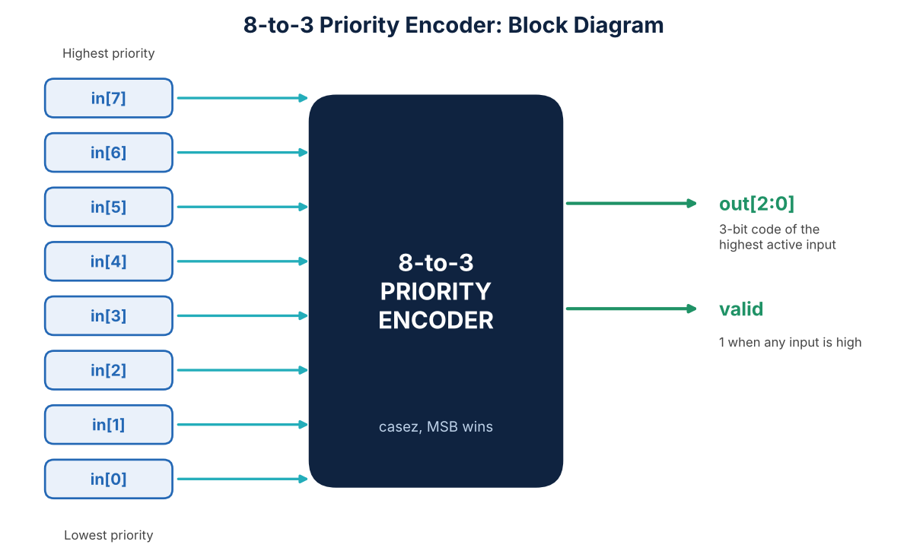
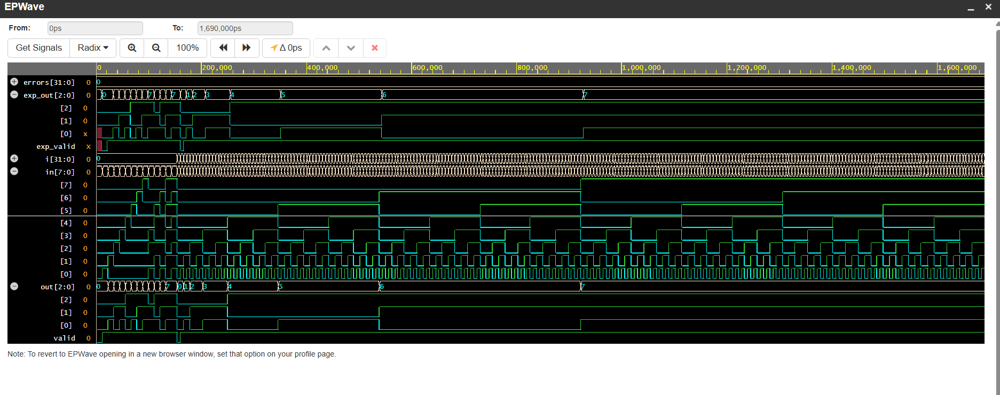

# 8-to-3 Priority Encoder

RTL design and verification of an **8-to-3 priority encoder** in Verilog HDL, built as part of the *Digital Design Practical* (Verilog HDL) in the Department of Electronics and Communication Engineering.

A priority encoder turns eight request lines into a 3-bit binary code. When more than one request is high, the **highest-numbered input wins** (`in[7]` has the highest priority, `in[0]` the lowest). A `valid` flag tells you whether any input is active at all. The design is verified with a self-checking testbench that compares the DUT against a separate reference model, using directed vectors and an exhaustive sweep of all 256 inputs.

**Run it online:** [EDA Playground](https://edaplayground.com/x/pSEQ)

| Result | Value |
|---|---|
| Directed vectors | 14 (zero, each single input, 5 multi-input cases) |
| Exhaustive vectors | 256 (every possible input) |
| Total simulation length | 1,690 ns |
| `errors` counter in EPWave | 0 for the whole run |

## Features

- Purely combinational design, so no clock or reset is needed
- `casez` with `?` don't-cares gives the priority order directly
- `valid` output separates "no request" from "request on `in[0]`" (both give `out = 000`)
- Self-checking testbench with an independent reference model (LSB to MSB scan, last hit wins)
- Makefile for Icarus Verilog simulation and Yosys synthesis

## Block diagram



### Ports

| Port | Direction | Width | Purpose |
|---|---|---|---|
| `in` | input | 8 | Request lines, `in[7]` = highest priority |
| `out` | output | 3 | Binary index of the highest active input |
| `valid` | output | 1 | High when at least one input is high |

## Truth table

`X` means don't care: lower-priority inputs do not affect the output.

| `in[7:0]` | `out[2:0]` | `valid` | Selected request |
|---|---|---|---|
| `00000000` | `000` | 0 | No request |
| `00000001` | `000` | 1 | in[0] |
| `0000001X` | `001` | 1 | in[1] |
| `000001XX` | `010` | 1 | in[2] |
| `00001XXX` | `011` | 1 | in[3] |
| `0001XXXX` | `100` | 1 | in[4] |
| `001XXXXX` | `101` | 1 | in[5] |
| `01XXXXXX` | `110` | 1 | in[6] |
| `1XXXXXXX` | `111` | 1 | in[7] |

Example: `in = 10101010` has in[7], in[5], in[3] and in[1] high. in[7] wins, so `out = 111` and `valid = 1`.

## Repository structure

```
priority-encoder-8to3/
├── rtl/
│   └── priority_encoder_8to3.v   # RTL design (module priority_encoder_8to3)
├── tb/
│   └── tb_priority_encoder.v     # self-checking testbench
├── synth/
│   └── syn.ys                    # Yosys synthesis script
├── sim/                          # simulation outputs are written here
├── docs/
│   ├── images/                   # block diagram and EPWave waveform
│   └── presentation/
│       └── priority_encoder_presentation.pdf
├── Makefile
├── LICENSE
└── README.md
```

## How to run

### Option 1: EDA Playground (no installation)

1. Open the [playground link](https://edaplayground.com/x/pSEQ).
2. Choose **Icarus Verilog** as the simulator and tick **Open EPWave after run**.
3. Click **Run**. The console ends with `TEST PASSED: all vectors matched.`
4. In EPWave, click **Get Signals** and add `in`, `out`, `valid`, `exp_out`, `exp_valid` and `errors`.

### Option 2: Local simulation with Icarus Verilog

```bash
sudo apt install iverilog        # or install from https://steveicarus.github.io/iverilog/
make sim
```

The run prints one `Time=... | in=... | out=... | valid=...` line per input change and ends with:

```
TEST PASSED: all vectors matched.
```

It also writes `sim/priority_encoder.vcd`, which you can open in GTKWave, and saves the log to `sim/sim.log`.

### Option 3: Synthesis with Yosys

```bash
sudo apt install yosys
make synth
```

This writes `synth/synth.v` (gate-level netlist) and `synth/stat.txt` (cell statistics).

## Verification

The testbench has three parts:

| Part | Vectors | What it checks |
|---|---|---|
| Single inputs | `00000000`, then `00000001` up to `10000000` | Each input alone gives its own index; zero gives `valid = 0` |
| Multiple active inputs | `00001101`, `00110110`, `01010101`, `10101010`, `11111111` | The highest active input always wins |
| Exhaustive | All 256 values of `in` | Full equivalence with the reference model |

After each vector the testbench waits 1 ns and compares `out` and `valid` with `exp_out` and `exp_valid` using `!==`, so an `x` or `z` also counts as a failure. Any mismatch prints a `FAIL:` line and increments `errors`.

### Waveform



How to read it:

- `errors` stays at 0 for the entire run.
- `out` and `exp_out` show the same value at every step.
- `i` starts counting at about 154 ns, where the directed tests end and the exhaustive sweep begins (14 directed vectors at 11 ns each).
- `out` steps up to 4, 5, 6 and 7 when `i` first reaches 16, 32, 64 and 128.
- `valid` is low only when `in = 00000000`.
- The red `x` at the start of `exp_out` and `exp_valid` is expected: they are first assigned at the first `check`, 10 ns in.

## Presentation

The project slides are in [`docs/presentation/priority_encoder_presentation.pdf`](docs/presentation/priority_encoder_presentation.pdf). They walk through the idea with a 4-to-2 priority encoder; the RTL in this repository is the 8-to-3 version of the same design.

## Future scope

- Parameterised width, so one module covers 4-to-2, 8-to-3 and 16-to-4
- Cascading two 8-to-3 encoders into a 16-to-4 encoder
- A registered (clocked) version for use in an interrupt controller
- FPGA implementation with timing, power and area measurement

## Team

| Name | Register number |
|---|---|
| Harsha Vardhan E | 312324106056 |
| Harrish S | 312324106055 |
| Hitesh Kumar M | 312324106061 |
| Harshyan PS | 312324106058 |
| Kavi Priayan D | 312324106077 |

Department of Electronics and Communication Engineering.

## License

Released under the [MIT License](LICENSE).
